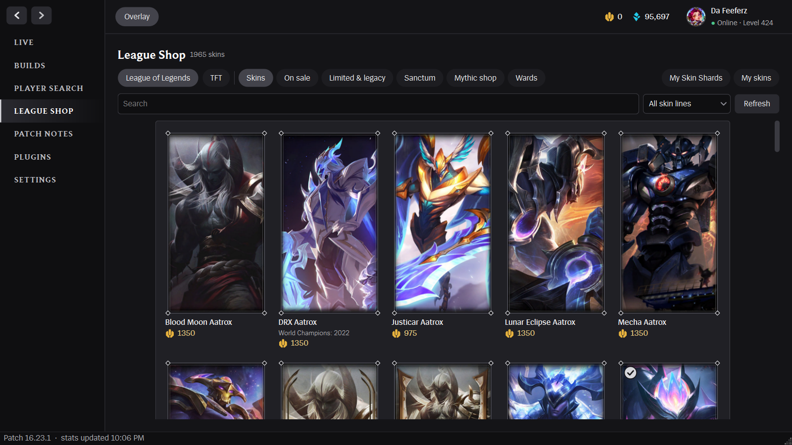
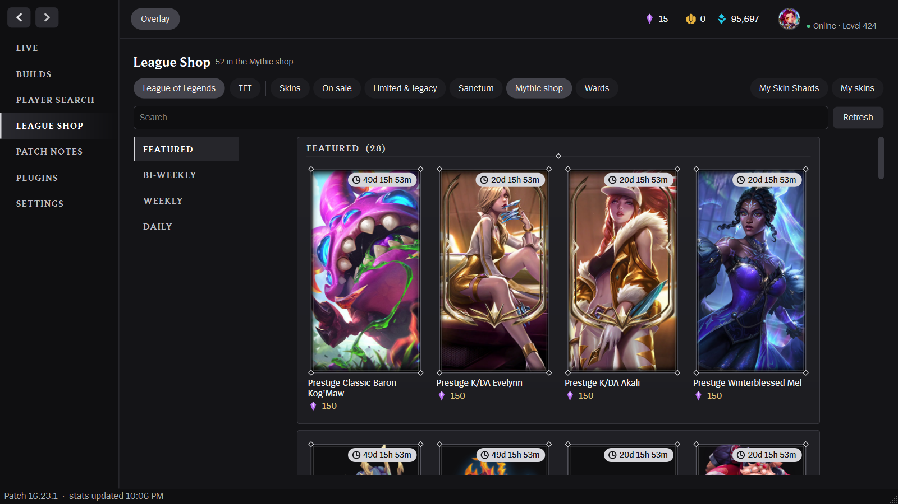
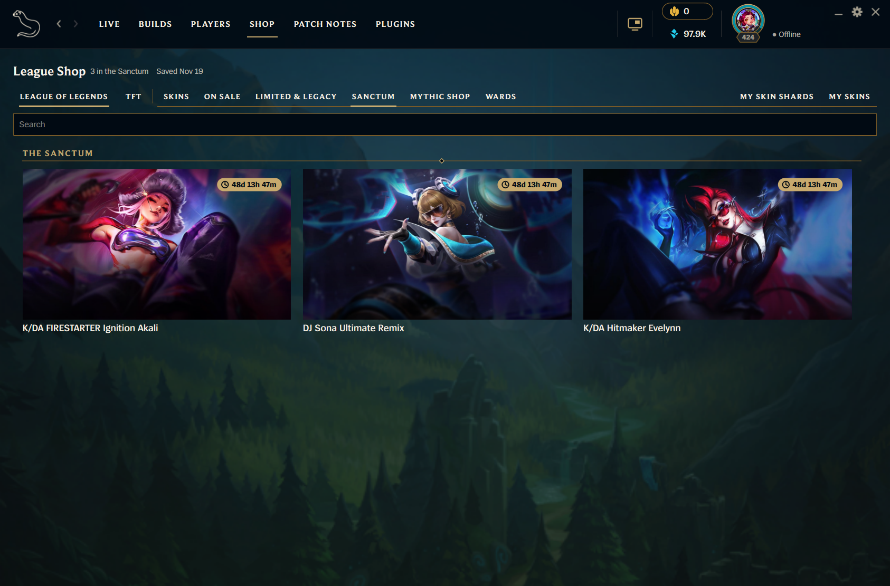

  

  # Feeferz Client

  A League of Legends app for Windows: builds, champ select help, player lookups and the League shop.

  
  

## Download

Get it from **[Releases](https://github.com/RosieCozy/League-of-Legends-Feeferz-Client/releases/latest)**. Use the Setup exe to install, or the zip to run it without installing. It updates itself.

Windows 10 or 11. Set League to Borderless for the in-game overlay.

## What it does

**Builds**: runes, items, skill order, matchups and a tier list for every champion, by rank and lane. Off-meta shows odd builds that won games. Import runes and item sets into the client in one click.

**Live**: in champ select, your lane opponent, counters and builds ready to import. In game, everyone's rank and a small overlay with gold difference and CS. Between games, your playstyle compared to others in your role.

**Players**: look up anyone's rank, match history and seasons.

**Shop**: every skin with prices and sales, the Sanctum, the Mythic shop and your skin shards.

**Plugins** (optional): Mod Loader for custom skins through LTK Manager, and Discord Rich Presence.

---

Made by Throwsie. Free to use. All rights reserved: see [LICENSE](LICENSE).

Feeferz Client isn't endorsed by Riot Games and doesn't reflect the views or opinions of Riot Games or anyone officially involved in producing or managing Riot Games properties. Riot Games, and all associated properties are trademarks or registered trademarks of Riot Games, Inc.
