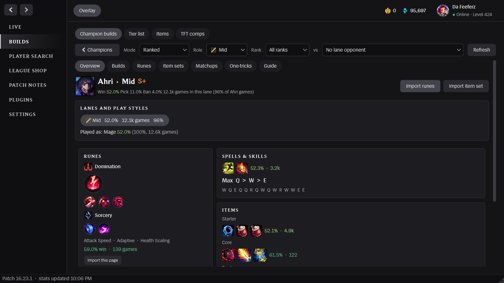
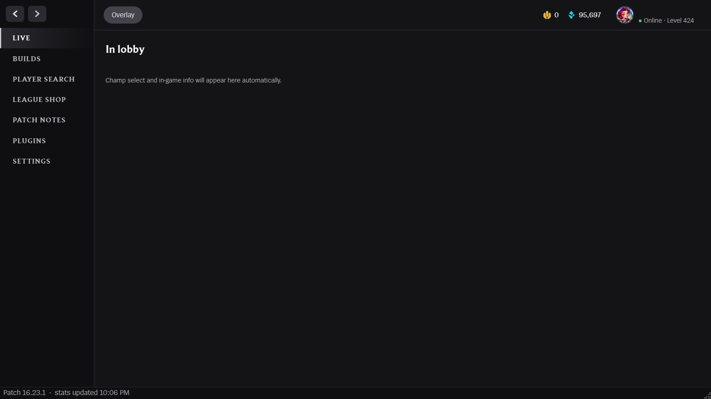
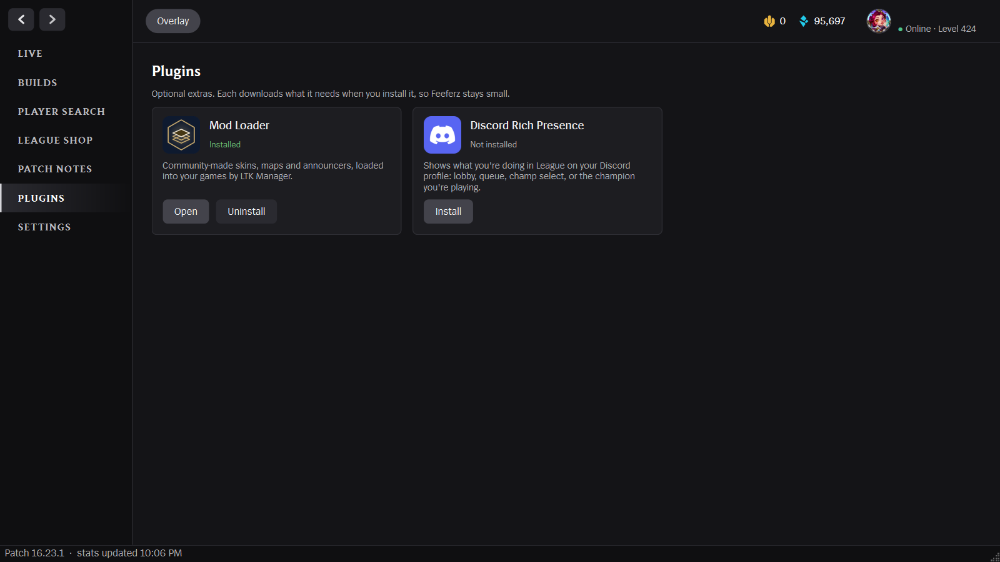

  

  # Feeferz Client

  A free League of Legends companion app I've been working on. Builds, champ select help, player stats, the whole shop and a bunch more, all in one place so you don't need 5 websites open.

  
  

## Download

Grab **FeeferzClient-Setup.exe** from [Releases](https://github.com/RosieCozy/League-of-Legends-Feeferz-Client/releases/latest) and run it. That's it. No account, no sign-up, nothing else to install.

It updates itself too, so you only ever have to download it once.

You'll need Windows 10 or 11 (and League, obviously). If you want the in-game overlay, set League to Borderless.

## Builds

Pick a champ and you get the best build for your rank, plus what most people play and some off-meta stuff if you want to get weird with it. Runes, item sets, matchups and a guide are all there, and you can import runes and items into the client in one click.

There's also a tier list by lane, every item in the game (stats, cost, who builds it best), TFT comps, and a One-tricks tab where you can see what the top players on each champ are actually doing right now.

## League Shop

I got tired of clicking through the client store, so the whole thing is in here. Skins, sales, limited and legacy stuff, wards, your skin shards, the TFT store, the Sanctum and the Mythic shop, all with how long they're around for. Stuff you already own gets a little check mark.

It's view only, you still buy things in the client.

## Live

This one kind of runs itself. Once you're in champ select it shows your likely lane opponent, counters, the matchup win rate, and runes/items ready to import. It'll also suggest safe blind picks from your own champ pool, tell you what a dodge would cost you, show duo synergy with your lane partner, and rank the ARAM bench so you know what to swap for.

When the game loads you can see everyone's rank and stats, and after the game you get a little card with your result, LP and how it went. There's auto-accept for queue pops too, if you're the type to walk away from your PC.

### In game

A few small overlays that sit on top of the game: a champ select panel next to the client, a strip with the gold difference and your next item, and a CS per minute tracker against your lane opponent. You can drag them wherever, or just turn them off.

## Player search

Look up anyone by Riot ID. Your friends and people you've recently played with show up first. You get their full match history (builds, runes, damage, objectives, bans), their season stats, and some insights on how they play, what they're good at and what they're not.

## Patch notes

League's patch notes, but with your most played champs at the top so you can see right away if you got buffed or nerfed. Feeferz's own patch notes are in there too, and on the [Releases](https://github.com/RosieCozy/League-of-Legends-Feeferz-Client/releases) page.

## Plugins

Optional extras. Install what you want, uninstall whenever.

- **Mod Loader**: custom skins, voices, announcers and maps. It checks each mod against your game before you queue, so you know if something's going to break. You can also right-click a mod to test it by itself in Practice Tool. It uses LTK Manager in the background.
- **Discord Rich Presence**: shows what you're doing in League on your Discord profile, like your queue, champ, KDA and rank.

## Settings

There are Dark, Light and League client themes, and you can use your profile background, the Summoner's Rift forest, or keep it plain. It uses the same fonts as the League client and matches your client's window size, so it feels like part of the game. Changes show up right away, and you just hit Save when you're happy with it.

## Why I made it

I wanted something free, with no ads, that doesn't eat your PC. I personally don't like downloading apps that run ads in the background, so this doesn't, and it never will. It's built in C++ so it barely uses anything while it's sitting there.

It's still very much a work in progress and I'm updating it a lot, so if something's off or you have an idea, let me know.

---

Made by Throwsie. Free to use. All rights reserved, see [LICENSE](LICENSE).

Feeferz Client isn't endorsed by Riot Games and doesn't reflect the views or opinions of Riot Games or anyone officially involved in producing or managing Riot Games properties. Riot Games, and all associated properties are trademarks or registered trademarks of Riot Games, Inc.
